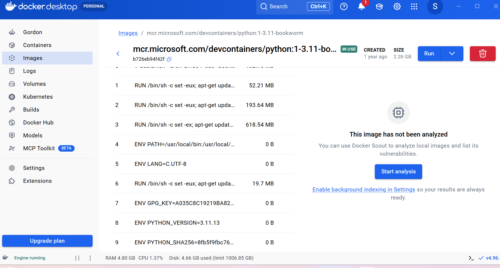
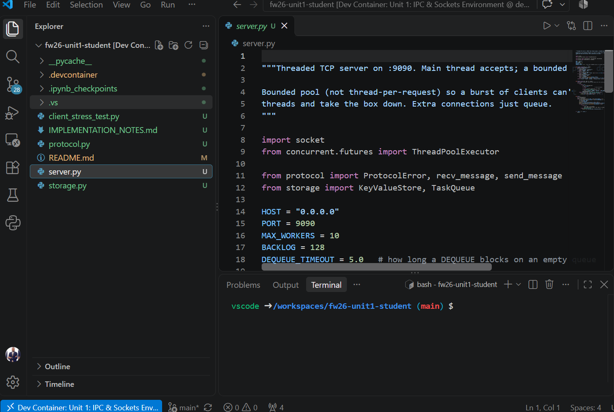
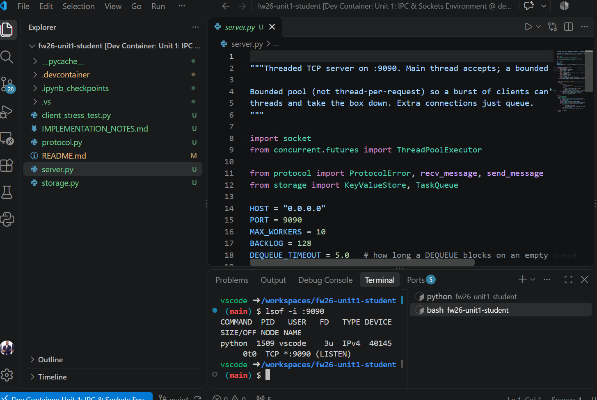
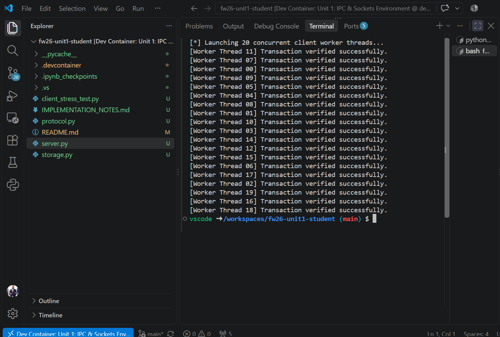
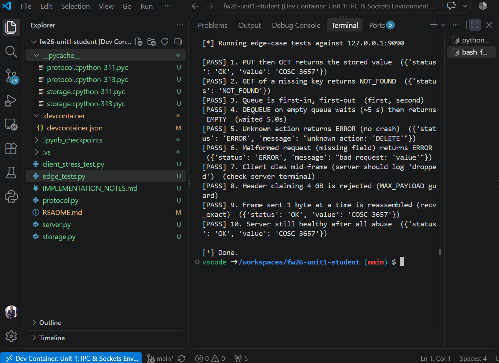
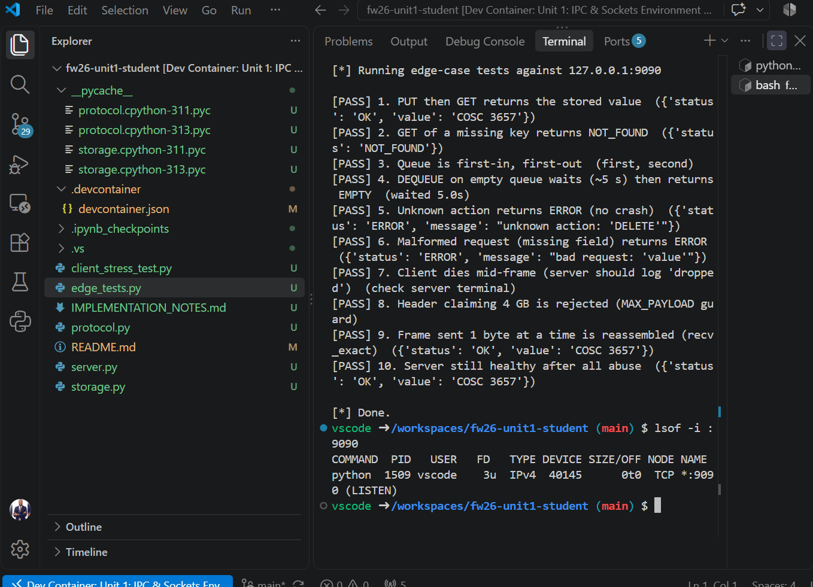

# Distributed System: Concurrent Socket Server

**Unit 1 — IPC & Sockets: How I Ran the Program**
Brian Sekiziyivu · October 21, 2026

## Summary

I ran a threaded TCP server (port 9090) inside the course Dev Container (Python 3.11, Debian).
The server uses a pool of 10 threads and a shared key-value store and queue. I confirmed it was
listening, ran the 20-client stress test (all passed), then ran 10 edge-case tests (all passed).

| File | Role |
| --- | --- |
| `server.py` | Accepts clients; 10-thread pool |
| `protocol.py` | Sends/receives length-prefixed messages |
| `storage.py` | Thread-safe key-value store + task queue |
| `client_stress_test.py` | 20 clients at once |
| `edge_tests.py` | 10 error/abuse checks |

## Step 1 — Load the environment

Docker Desktop pulled the course image (Python 3.11 bookworm). In VS Code I chose
**Reopen in Container**.



Docker image in use: `mcr.microsoft.com/devcontainers/python:1-3.11-bookworm`

## Step 2 — Open the project

VS Code now runs inside the container (bottom-left: *Dev Container: Unit 1*, Python 3.11.13).



Project files and `server.py`.

## Step 3 — Start the server

Terminal 1 runs the server. Terminal 2 checks the port is open.

```bash
python server.py
lsof -i :9090
```



Result: `python` is LISTENING on TCP `*:9090`.

## Step 4 — Stress test

Terminal 2 sends 20 clients at the same time.

```bash
python client_stress_test.py
```



All 20 worker threads: "Transaction verified successfully."

## Step 5 — Edge-case tests

Added `edge_tests.py` to the project folder and ran it.

```bash
python edge_tests.py
```



10/10 PASS: bad requests, 4 GB header, dropped client, 1-byte frames, empty-queue wait.

## Step 6 — Server still alive

After all the abuse, the port is still listening — the server never crashed.

```bash
lsof -i :9090
```



Same PID 1509 still listening on `:9090`.

## Result

Server handled 20 concurrent clients and 10/10 edge cases with no crash. Stopped it with `Ctrl + C`.
